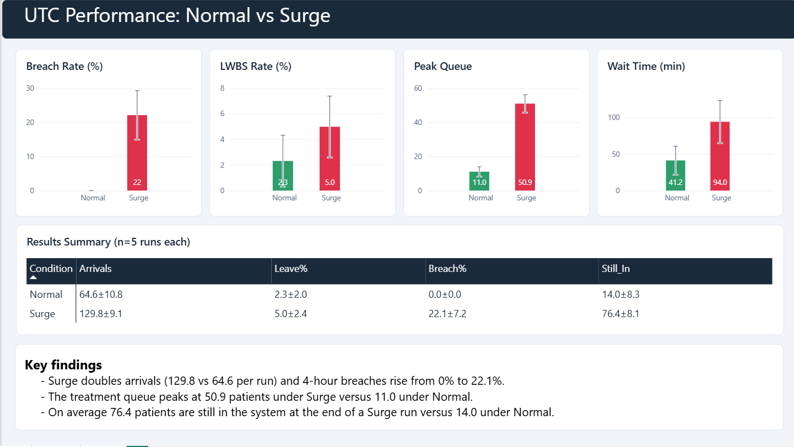
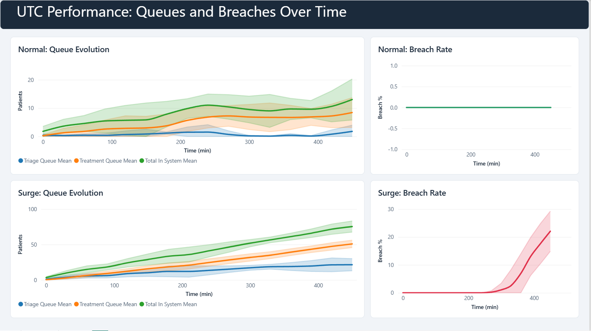
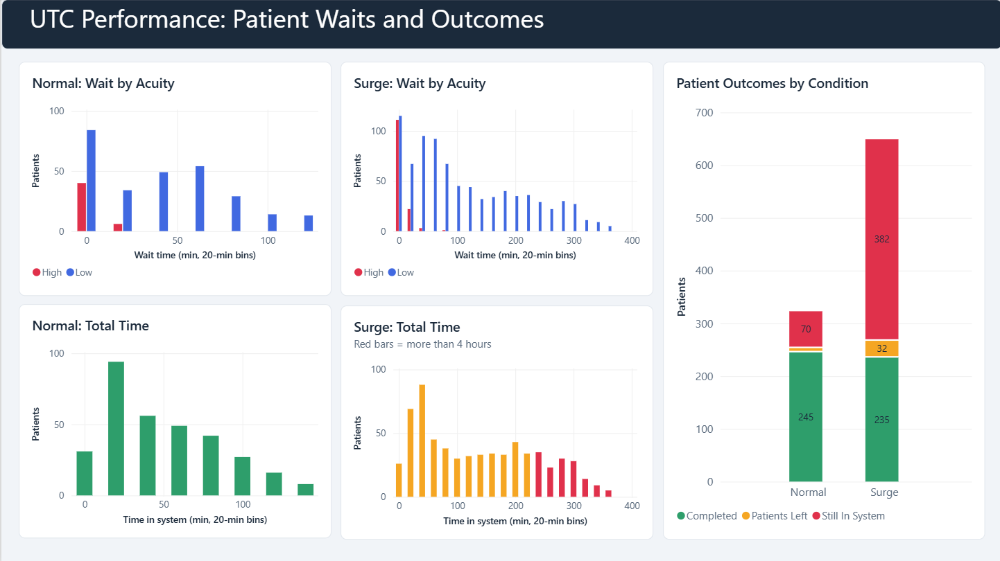

# Urgent Treatment Centre: Normal vs Surge Demand (Power BI dashboard)

An interactive Power BI dashboard built from the discrete-event simulation of an urgent treatment
centre (UTC) developed for my dissertation. The model compares a **Normal** demand day with a
**Surge** day (1 triage nurse, 2 doctors, 5 replications each, 450 simulated minutes) and shows how
the surge overwhelms the treatment queue.

## Key findings (mean ± SD across 5 runs)

| Measure | Normal | Surge |
|---|---|---|
| Arrivals per run | 64.6 ± 10.8 | 129.8 ± 9.1 |
| 4-hour breach rate | 0.0% | 22.1 ± 7.2% |
| Left without being seen | 2.3 ± 2.0% | 5.0 ± 2.4% |
| Wait time at end of run (min) | 41.2 ± 19.6 | 94.0 ± 29.2 |
| Peak treatment queue | 11.0 ± 2.9 | 50.9 ± 5.3 |
| Patients still in system at end | 14.0 ± 8.3 | 76.4 ± 8.1 |

## Dashboard pages

1. **Overview**: Normal vs Surge comparison with error bars, and the results summary table.
2. **Over time**: queue evolution (triage, treatment, total) and cumulative 4-hour breach rate.
3. **Patients**: waiting-time distributions by acuity, time-in-system histograms with the 4-hour limit, and patient outcomes.

## Repository contents

| Path | What it is |
|---|---|
| `data/` | Simulation outputs (5 CSV files) |
| `powerbi/UTC_Normal_vs_Surge.pbix` | The dashboard (open in Power BI Desktop) |
| `powerbi/power_query.m` | Power Query scripts that load and clean the CSVs |
| `powerbi/measures.dax` | Calculated tables and all DAX measures |
| `powerbi/theme_UTC.json` | Colour theme |
| `docs/figures/` | The original dissertation figures the dashboard reproduces |
| `docs/expected_values.md` | Reference values to check the dashboard against |
| `BUILD_GUIDE.md` | Step-by-step instructions to rebuild the dashboard |

## How to open

1. Install Power BI Desktop (Windows).
2. Clone the repo and open `powerbi/UTC_Normal_vs_Surge.pbix`.
3. Home > Transform data > Edit parameters > set `DataFolder` to the full path of the `data` folder, ending with `\`, then Refresh.

## Method notes

- Each metric is computed per run, then the mean and sample standard deviation are taken across the 5 runs.
- A patient counts as a 4-hour breach when total time in the system is 240 minutes or more.
- "Still in system" = arrivals minus completed minus left at the end of the 450-minute run.
- Error-bar lower bounds are clamped at zero.
